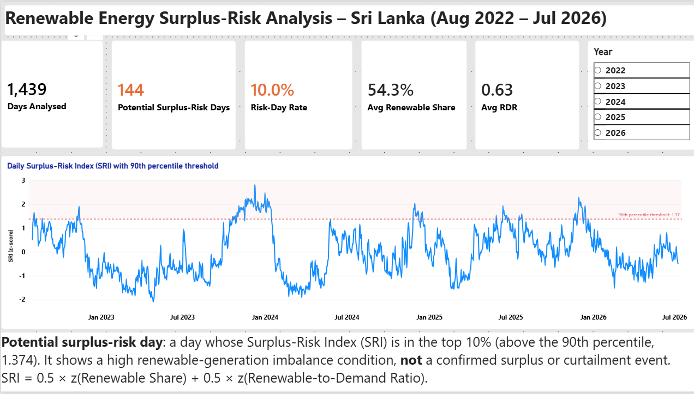
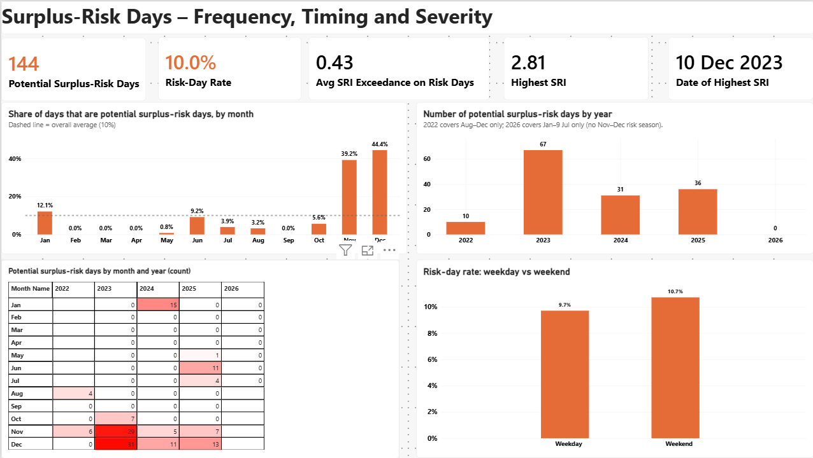
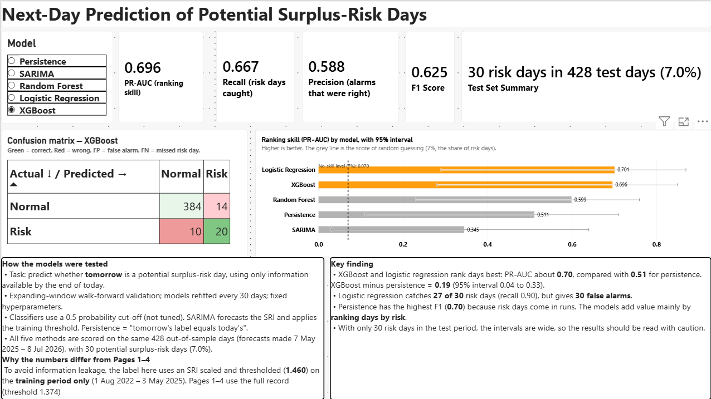

# Renewable Energy Surplus Risk Analysis – Sri Lanka

**Final-year research project** · BSc in Financial Mathematics and Industrial Statistics
Department of Mathematics, Faculty of Science, University of Ruhuna, Sri Lanka

**Author:** A.M.I Ansath · **Supervisor:** Thilan A. W. L. P.

Daily surplus-risk analysis of Sri Lanka's electricity generation (Ceylon Electricity Board data, 1 Aug 2022 – 9 Jul 2026): a Surplus-Risk Index (SRI), a Power BI dashboard, and leakage-free next-day prediction models.



---

## 1. The problem

Sri Lanka aims for **70% renewable electricity by 2030**. As an island grid, it **cannot export** extra power to neighbouring countries. On days with high renewable generation and low demand, the system can produce more renewable power than it can use. This study calls these days **potential surplus-risk days**.

> **Important:** a *potential surplus-risk day* is a statistical label for a high renewable-imbalance condition. It is **not** a confirmed surplus or curtailment event.

## 2. Objectives

1. Analyse temporal and seasonal patterns in renewable and fossil-fuel generation.
2. Build renewable–demand imbalance indicators and identify potential surplus-risk days.
3. Predict **tomorrow's** potential surplus-risk day from information available by the end of today.

## 3. Data

- **Source:** daily generation data published by the **Ceylon Electricity Board (CEB)**.
- **Period:** 1 August 2022 – 9 July 2026, **1,439 consecutive days**, no missing dates.
- **Variables:** daily generation by source (hydro, solar, wind, biomass, coal, oil, in GWh) and daily peak demand (MW).
- Daily energy demand is not published, so it is **estimated**:
  `D_est = peak demand (MW) × 24 h × 0.70 ÷ 1000` (GWh), where 0.70 is the load factor.

## 4. Method

### Indicators (Objectives 1 and 2)

| Indicator | Formula | Meaning |
|---|---|---|
| **RS** – Renewable Share | renewable generation ÷ total generation | How renewable-dominated the day is |
| **RDR** – Renewable-to-Demand Ratio | renewable generation ÷ estimated demand | How close renewables alone come to meeting demand |
| **SRI** – Surplus-Risk Index | 0.5 × z(RS) + 0.5 × z(RDR) | Combined, standardised risk score |

A day is a **potential surplus-risk day** when its SRI is above the **90th percentile** (1.374 on the full record).
A **Mann–Kendall test** was used to check for a long-term trend.

### Next-day prediction (Objective 3)

- **Target:** is tomorrow a potential surplus-risk day?
- **Models:** persistence rule ("tomorrow = today"), SARIMA (forecasts the SRI), logistic regression, random forest, XGBoost.
- **No information leakage:** the SRI scaling and the threshold (**1.460**) are estimated on the **training period only** (1 Aug 2022 – 3 May 2025).
- **Validation:** expanding-window walk-forward, models refitted every 30 days, fixed hyperparameters, 0.5 probability cut-off (not tuned).
- **Test set:** the same **428 out-of-sample days** for all models (forecasts made 7 May 2025 – 8 Jul 2026), with **30 potential surplus-risk days (7.0%)**.
- **Uncertainty:** 95% intervals from a moving-block bootstrap (14-day blocks, 2,000 resamples).

## 5. Key findings

### Descriptive (full record)

- **Average renewable share: 54.3%.** On a typical day, renewables meet about **63%** of estimated demand.
- **144 potential surplus-risk days (10.0%)**, about 37 per year.
- Risk days are **strongly seasonal**: December **44.4%** of days, November **39.2%**, January **12.1%**; February–April and September **0%**.
- Renewable share is highest in the 2nd Inter-monsoon (Oct–Nov, **63.5%**) and lowest in the 1st Inter-monsoon (Mar–Apr, **41.7%**).
- Weekday and weekend risk rates are similar (**9.7%** vs **10.7%**), so the risk is driven by **season**, not by lower weekend demand.
- Highest SRI: **2.81** on **10 December 2023**.
- **No significant long-term trend** (Mann–Kendall). The record is short, so this is interpreted with caution.
- **Robustness:** the same risk days are found for load factors 0.65–0.75, and 89–97% agreement for SRI weights 0.3–0.7.

### Predictive (428 test days, 30 risk days)

| Model | Precision | Recall | F1 | PR-AUC (95% interval) | ROC-AUC |
|---|---|---|---|---|---|
| Persistence | 0.700 | 0.700 | **0.700** | 0.511 (0.11 – 0.71) | 0.839 |
| SARIMA | 0.529 | 0.300 | 0.383 | 0.345 (0.03 – 0.64) | 0.707 |
| Random forest | 0.611 | 0.367 | 0.458 | 0.599 (0.23 – 0.76) | 0.940 |
| Logistic regression | 0.474 | **0.900** | 0.621 | **0.701** (0.29 – 0.87) | 0.939 |
| XGBoost | 0.588 | 0.667 | 0.625 | 0.696 (0.28 – 0.85) | **0.942** |

- **XGBoost and logistic regression rank days best:** PR-AUC about **0.70**, compared with **0.51** for persistence. XGBoost minus persistence = **0.19** (95% interval 0.04 to 0.33).
- **Logistic regression catches 27 of 30 risk days** (recall 0.90), but gives 30 false alarms.
- **Persistence has the highest F1 (0.70)** because risk days come in runs. The models add value mainly by **ranking days by risk**.
- With only 30 risk days in the test period, the intervals are wide.

## 6. Power BI dashboard

Six pages. The `.pbix` file and a PDF of all pages are in [`powerbi/`](powerbi/).

| Page | What it shows |
|---|---|
| 1. Overview | KPIs and the daily SRI with the 90th-percentile threshold |
| 2. Generation Patterns | Monthly generation by source, renewable share by month and season |
| 3. Surplus-Risk Days | Risk-day rate by month, by year, month × year heatmap, weekday vs weekend |
| 4. Data Quality | Source–total consistency, missing data notes, robustness checks |
| 5. Next-Day Prediction | Model metrics, confusion matrix, PR-AUC comparison with 95% intervals |
| 6. Prediction – Daily View | Daily predicted risk score, test-period SRI, feature importance |

| | |
|---|---|
|  |  |
|  |  |


## 7. Repository structure

```
renewable-surplus-risk-sri-lanka/
├── README.md
├── LICENSE
├── .gitignore
├── data/
│   ├── final_cleaned_data.xlsx      # cleaned daily CEB data (model input)
│   └── powerbi/                     # CSV files used by the dashboard
├── code/
│   ├── objective1_2/                # descriptive analysis, indicators, SRI, trend test
│   └── objective3/
│       ├── objective3_leakfree.py   # leakage-free walk-forward models
│       └── objective3_checks.py     # checks and bootstrap intervals
├── powerbi/
│   ├── SurplusRisk_Dashboard.pbix
│   └── SurplusRisk_Dashboard.pdf
├── docs/                            # report, abstract, presentation
└── screenshots/                     # one image per dashboard page
```

## 8. How to run the prediction code

1. Install Python 3 and the packages:
   ```
   pip install pandas numpy scikit-learn statsmodels xgboost matplotlib openpyxl
   ```
2. Put `final_cleaned_data.xlsx` in the **same folder** as the scripts (copy it from `data/` into `code/objective3/`).
3. Run the scripts from that folder:
   ```
   python objective3_leakfree.py
   python objective3_checks.py
   ```
4. The results should match the table in Section 5.

## 9. Limitations

- **Demand is estimated** from peak demand and an assumed load factor, because daily energy demand is not published.
- The risk label is a **statistical proxy**. It is not observed curtailment data.
- The test period has **only 30 risk days**, so model comparisons have wide uncertainty.
- The record is **about four years**, which limits trend analysis.
- Biomass was not reported before 18 Nov 2022 and was set to 0 (biomass is about 0.6% of total generation).

## 10. Licence and data

- **Code:** MIT Licence (see [`LICENSE`](LICENSE)).
- **Data:** generation data come from the Ceylon Electricity Board and are included here only to make the analysis reproducible. Please credit CEB as the original source.

## 11. Contact

Ansath Ahamed – [LinkedIn](https://www.linkedin.com/in/ansath-ahamed-227775279) · [Email](mailto:ansath005@gmail.com)
