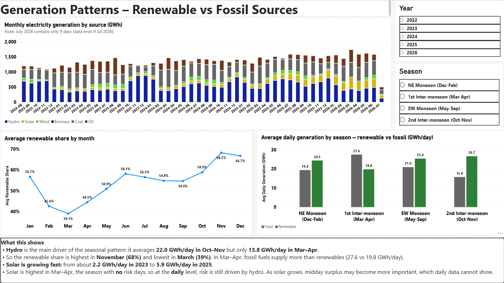
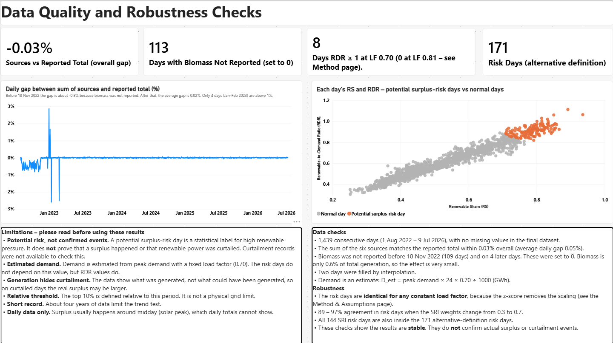
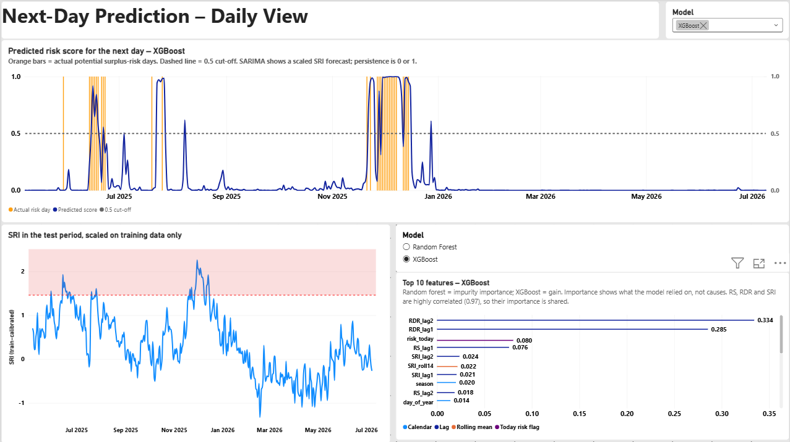

# Renewable Energy Surplus Risk Analysis – Sri Lanka

**Final-year research project** · BSc in Financial Mathematics and Industrial Statistics
Department of Mathematics, Faculty of Science, University of Ruhuna, Sri Lanka

**Author:** M.I Ansath Ahamed· **Supervisor:** Thilan A. W. L. P.

Daily surplus-risk analysis of Sri Lanka's electricity generation (Ceylon Electricity Board data, 1 Aug 2022 – 9 Jul 2026): a Surplus-Risk Index (SRI), a Power BI dashboard, and leakage-free next-day prediction models.


---

## 1. The problem

Sri Lanka aims for **70% renewable electricity by 2030**. As an island grid, it **cannot export** extra power to neighbouring countries. On days with high renewable generation and low demand, the system can produce more renewable power than it can use. This study calls these days **potential surplus-risk days**.

> **Important:** a *potential surplus-risk day* is a statistical label for a high renewable-imbalance condition. It is **not** a confirmed surplus or curtailment event.

## 2. Objectives

1. Analyse temporal and seasonal patterns in renewable and fossil-fuel generation.
2. Build renewable–demand imbalance indicators and identify potential surplus-risk days.
3. Predict **tomorrow's** potential surplus-risk day from information available by the end of today.

## 3. Data

- **Source:** daily generation data published by the **Ceylon Electricity Board (CEB)**.
- **Period:** 1 August 2022 – 9 July 2026, **1,439 consecutive days**, no missing dates.
- **Variables:** daily generation by source (hydro, solar, wind, biomass, coal, oil, in GWh) and daily peak demand (MW).
- Daily energy demand is not published, so it is **estimated**:
  `D_est = peak demand (MW) × 24 h × 0.70 ÷ 1000` (GWh), where 0.70 is the load factor.

## 4. Method

### 4.1 Building the Surplus-Risk Index (SRI)

**Step 1 – Two daily indicators**

| Indicator | Formula | What it measures |
|---|---|---|
| **RS** – Renewable Share | renewable generation ÷ total generation | How renewable-dominated the day's supply is |
| **RDR** – Renewable-to-Demand Ratio | renewable generation ÷ estimated demand | How close renewables alone come to covering demand |

Renewable = hydro + solar + wind + biomass. Fossil = coal + oil.

**Step 2 – Put both on the same scale.** RS and RDR have different units and spreads, so each is standardised with a z-score over the study period: `z = (value − mean) ÷ standard deviation`.

**Step 3 – Combine them.** `SRI = 0.5 × z(RS) + 0.5 × z(RDR)`

**Step 4 – Flag the extreme days.** A day is a **potential surplus-risk day** when its SRI is above the **90th percentile** (1.374), i.e. the top 10% of days.

### 4.2 Why equal weights (0.5 / 0.5)?

- RS and RDR describe two sides of the same problem: the *mix* of supply (RS) and the *size of renewables relative to demand* (RDR). There is no published or physical basis for giving one more importance, so equal weights are the neutral choice.
- The two indicators are highly correlated (r = 0.97), so the result is not sensitive to the exact weights. With weights from 0.3 to 0.7, **89–97% of risk days stay the same** (overlap of the two risk-day sets: shared days ÷ all flagged days).

### 4.3 Why the 90th percentile?

- Surplus risk is a question about **extreme** days, not average days. The top 10% gives a clear, standard definition of "unusually high" and still leaves enough days (144, about 37 per year) to study patterns and train models.
- There is no official CEB threshold for surplus or curtailment, so a **relative** (percentile) threshold is used instead of a fixed value.
- **The main finding does not depend on this choice:**

| Threshold | SRI cut-off | Risk days | Share in Nov–Jan | Days in Feb–Apr and Sep |
|---|---|---|---|---|
| 85th percentile | 1.161 | 216 | 67.1% | 4 |
| **90th percentile (used)** | **1.374** | **144** | **81.2%** | **0** |
| 95th percentile | 1.778 | 72 | 98.6% | 0 |

### 4.4 Estimating daily demand – assumptions and their effect

CEB publishes **daily peak demand (MW)**, not daily energy demand (GWh). Demand is therefore estimated as:

`D_est = peak demand (MW) × 24 h × load factor ÷ 1000`, with load factor = **0.70**.

**Assumptions**

1. The load factor is **the same on every day** (no change between seasons, weekdays and holidays).
2. The value 0.70 is taken as the middle of the historical range reported for Sri Lanka.

**What this means for the results**

- **The list of risk days does not depend on the load factor.** Any constant load factor multiplies RDR by a fixed number, and the z-score removes that scaling. So the SRI and the 144 risk days are identical for any constant value.
- **The absolute RDR values do depend on it.** They should be read as a *relative* index, not as "the share of demand met by renewables":

| Load factor | Average RDR | Days with RDR ≥ 1 |
|---|---|---|
| 0.65 | 0.677 | 55 |
| **0.70 (used)** | **0.629** | **8** |
| 0.75 | 0.587 | 1 |
| 0.81 (implied by the data, see below) | 0.544 | 0 |

- **Check against the data:** in an island grid that cannot export, daily total generation is close to the energy actually supplied. Dividing it by `peak × 24` gives an implied daily load factor of **0.81 on average** (range 0.66–1.11; only 8% of days fall in 0.65–0.75). A likely reason is that published load factors usually use the **yearly** peak, which gives lower values than a load factor based on each **day's** peak. So 0.70 probably **underestimates** daily demand, and RDR is probably **overstated** by about 15%. The statement "renewables meet about 63% of estimated demand" should therefore be treated as an upper estimate.
- The implied load factor changes only a little between months (0.79–0.83) and between weekdays and weekends (0.82 vs 0.79), so a constant value is a reasonable simplification for the **classification**, but not for exact demand levels.

### 4.5 Trend test

A **Mann–Kendall test** was used to check for a long-term trend in the indicators.

### 4.6 Next-day prediction (Objective 3)

- **Target:** is tomorrow a potential surplus-risk day?
- **Models:** persistence rule ("tomorrow = today"), SARIMA (forecasts the SRI), logistic regression, random forest, XGBoost.
- **No information leakage:** the SRI scaling and the threshold (**1.460**) are estimated on the **training period only** (1 Aug 2022 – 3 May 2025). This is why the number of risk days in the test period differs from the descriptive results.
- **Validation:** expanding-window walk-forward, models refitted every 30 days, fixed hyperparameters, 0.5 probability cut-off (not tuned).
- **Test set:** the same **428 out-of-sample days** for all models (forecasts made 7 May 2025 – 8 Jul 2026), with **30 potential surplus-risk days (7.0%)**.
- **Uncertainty:** 95% intervals from a moving-block bootstrap (14-day blocks, 2,000 resamples), which keeps the day-to-day dependence in the data.

## 5. Key findings

### Descriptive (full record)

- **Average renewable share: 54.3%.** The average RDR is 0.63 with a load factor of 0.70; this is an upper estimate (see Section 4.4).
- **144 potential surplus-risk days (10.0%)**, about 37 per year.
- Risk days are **strongly seasonal**: December **44.4%** of days, November **39.2%**, January **12.1%**; February–April and September **0%**.
- Renewable share is highest in the 2nd Inter-monsoon (Oct–Nov, **63.5%**) and lowest in the 1st Inter-monsoon (Mar–Apr, **41.7%**).
- Weekday and weekend risk rates are similar (**9.7%** vs **10.7%**), so the risk is driven by **season**, not by lower weekend demand.
- Highest SRI: **2.81** on **10 December 2023**.
- **No significant long-term trend** (Mann–Kendall). The record is short, so this is interpreted with caution.
- **Robustness:** the risk days are identical for any constant load factor, 89–97% the same for SRI weights 0.3–0.7, and the Nov–Jan concentration holds at the 85th, 90th and 95th percentiles.

### Predictive (428 test days, 30 risk days)

| Model | Precision | Recall | F1 | PR-AUC (95% interval) | ROC-AUC |
|---|---|---|---|---|---|
| Persistence | 0.700 | 0.700 | **0.700** | 0.511 (0.11 – 0.71) | 0.839 |
| SARIMA | 0.529 | 0.300 | 0.383 | 0.345 (0.03 – 0.64) | 0.707 |
| Random forest | 0.611 | 0.367 | 0.458 | 0.599 (0.23 – 0.76) | 0.940 |
| Logistic regression | 0.474 | **0.900** | 0.621 | **0.701** (0.29 – 0.87) | 0.939 |
| XGBoost | 0.588 | 0.667 | 0.625 | 0.696 (0.28 – 0.85) | **0.942** |

### How to read these results

**What each measure means here**

- **Recall** = share of the 30 risk days that the model caught. **Precision** = share of the model's alarms that were correct. **F1** = a balance of the two at the 0.5 cut-off.
- **PR-AUC** = how well the model *ranks* days by risk across all cut-offs. A model that guesses at random scores about **0.07** (the share of risk days), not 0.5. This is why PR-AUC is the main measure here.
- **ROC-AUC** looks high for most models (0.84–0.94) because 93% of days are normal and easy to rank. With rare events it can look better than the model really is, so it is reported but not used to choose the best model.

**Why the small number of risk days matters**

- There are only **30 risk days**, so **one day changes recall by 3.3 percentage points**.
- The 30 days come in only **9 separate episodes** (runs of consecutive risk days), mostly in June 2025 and late November to mid-December 2025. The test covers **one** November–December season, so the effective sample is closer to 9 events than to 30.
- The 95% intervals are wide and **overlap for most models**. The one paired comparison tested, XGBoost minus persistence, has an interval of 0.04 to 0.33 that excludes zero; the other differences between models should not be treated as proven.

**What the results show**

- **Persistence is strong because risk days come in runs.** It misses only the **first day of each episode** (9 misses = 9 episodes) and gives one false alarm on the day after each episode ends (9 false alarms). This is why it has the highest F1 (0.70).
- **The models add value mainly by ranking days and warning at the start of an episode.** XGBoost and logistic regression reach PR-AUC about **0.70**, compared with **0.51** for persistence. Logistic regression caught the **first day of 6 of the 9 episodes**, which persistence cannot do by design (XGBoost: 2 of 9).
- **Logistic regression is the most cautious model:** it catches **27 of 30** risk days (recall 0.90), but about half of its alarms are false (30 of 57; precision 0.47).
- **The 0.5 cut-off was not tuned.** Precision, recall and F1 would change with a different cut-off; PR-AUC does not depend on it.
- These results describe **one test year**. They should be confirmed on more seasons before any operational use.

## 6. Power BI dashboard

Six pages. The `.pbix` file and a PDF of all pages are in [`powerbi/`](powerbi/).

| Page | What it shows |
|---|---|
| 1. Overview | KPIs and the daily SRI with the 90th-percentile threshold |
| 2. Generation Patterns | Monthly generation by source, renewable share by month and season |
| 3. Surplus-Risk Days | Risk-day rate by month, by year, month × year heatmap, weekday vs weekend |
| 4. Data Quality | Source–total consistency, missing data notes, robustness checks |
| 5. Next-Day Prediction | Model metrics, confusion matrix, PR-AUC comparison with 95% intervals |
| 6. Prediction – Daily View | Daily predicted risk score, test-period SRI, feature importance |

| | |
|---|---|
|  |  |
|  |  |



## 7. Repository structure

```
renewable-surplus-risk-sri-lanka/
├── README.md
├── LICENSE
├── .gitignore
├── data/
│   ├── final_cleaned_data.xlsx      # cleaned daily CEB data (model input)
│   └── powerbi/                     # CSV files used by the dashboard
├── code/
│   ├── objective1_2/                # descriptive analysis, indicators, SRI, trend test
│   └── objective3/
│       ├── objective3_leakfree.py   # leakage-free walk-forward models
│       └── objective3_checks.py     # checks and bootstrap intervals
├── powerbi/
│   ├── SurplusRisk_Dashboard.pbix
│   └── SurplusRisk_Dashboard.pdf
├── docs/                            # report, abstract, presentation
└── screenshots/                     # one image per dashboard page
```

## 8. How to run the prediction code

1. Install Python 3 and the packages:
   ```
   pip install pandas numpy scikit-learn statsmodels xgboost matplotlib openpyxl
   ```
2. Put `final_cleaned_data.xlsx` in the **same folder** as the scripts (copy it from `data/` into `code/objective3/`).
3. Run the scripts from that folder:
   ```
   python objective3_leakfree.py
   python objective3_checks.py
   ```
4. The results should match the table in Section 5.

## 9. Limitations

1. **Potential risk, not confirmed events.** A potential surplus-risk day is a statistical label for a high renewable-imbalance condition. It is **not** an observed electricity surplus, and it does **not** show that renewable generation was curtailed. Curtailment records were not available, so the label could not be checked against real events.
2. **Estimated demand.** Daily demand is estimated from peak demand with a constant load factor of 0.70. The risk-day list does not depend on this value, but absolute RDR values do, and the data suggest 0.70 underestimates daily demand (Section 4.4).
3. **Generation hides curtailment.** The data show what was generated, not what *could* have been generated. On days when renewables were curtailed, the true surplus would be larger than the data suggest.
4. **Relative threshold.** The 90th percentile defines "extreme" relative to this period. It is not a physical grid limit, and the same threshold would flag 10% of days even in a period with no real surplus problem.
5. **Short record.** About four years of data limit the trend test and the number of independent seasons.
6. **Small test set.** Only 30 risk days in 9 episodes, all within one test year, so model results have wide uncertainty.
7. **Daily resolution.** Surplus problems usually happen at midday (solar peak). Daily totals cannot show these within-day conditions.
8. **Data gaps.** Biomass was not reported before 18 Nov 2022 and was set to 0 (biomass is about 0.6% of total generation).

## 10. Licence and data

- **Code:** MIT Licence (see [`LICENSE`](LICENSE)).
- **Data:** generation data come from the Ceylon Electricity Board and are included here only to make the analysis reproducible. Please credit CEB as the original source.

## 11. Contact

M.I Ansath Ahamed – [LinkedIn](https://www.linkedin.com/in/ansath-ahamed-227775279) · [Email](mailto:ansath005@gmail.com)
